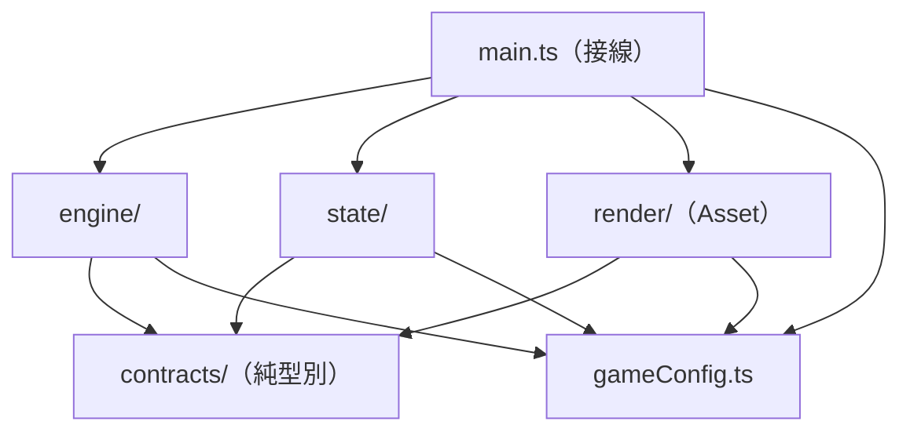
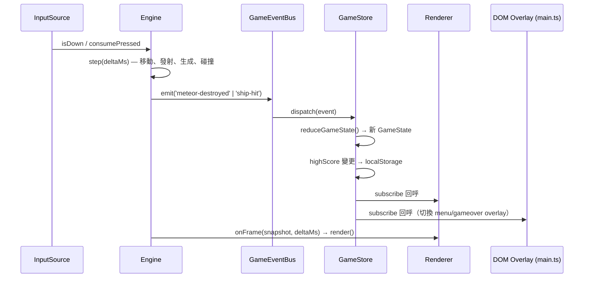

# ARCHITECTURE — Space Invader Style 太空射擊遊戲

本文件是 GANY-1 Epic 的**單一契約來源（Single Source of Truth）**。
QA（Stage 2）依此撰寫 red-state 測試，Engine/State Worker（Stage 3）依此撰寫生產代碼，
Asset-Technician（Stage 4）依此撰寫繪製邏輯。任何與本文件衝突的實作一律以本文件為準，
若需變更契約必須回本 issue 修訂本文件，不得各自解讀。

- 技術棧硬約束：HTML5 Canvas 2D（原生 `CanvasRenderingContext2D`，禁用第三方遊戲引擎）、
  TypeScript `strict`（原始碼 `any` 出現次數 = 0）、Vitest、Tailwind CSS（僅外圍 UI）。
- 座標系：畫布左上角為原點 `(0, 0)`，`x` 向右為正、`y` 向下為正，單位為 CSS 像素（邏輯像素）。
- 時間單位：速度一律為「像素／秒」，時間一律為毫秒（ms）。位移公式固定為
  `displacement = speed * (deltaMs / 1000)`，**禁止以「每幀固定位移」實作**。

---

## 0. 依賴規則（不可違反）



| 規則 | 說明 |
| --- | --- |
| `contracts/` 為**純型別**資料夾 | 只有 `type` / `interface` / `declare`，**零執行期程式碼**（不得有 `function`、`const`、`class`），因此被三方共同依賴也不會產生循環。 |
| `engine` ⇄ `state` 禁止互相 import | 兩者僅透過 `contracts` 的型別與 `GameEvent` 通訊。 |
| `engine` → `render`、`state` → `render` 禁止 | 渲染層永遠是消費者，不被遊戲邏輯依賴。 |
| `render` → `engine` / `state` 禁止 | 渲染層只吃 `RenderFrame`（資料快照），不讀引擎內部。 |
| `main.ts` 是唯一的 Composition Root | 只有 `main.ts` 可以同時 import 三個模組並接線；任何子模組不得 import `main.ts`。 |
| `gameConfig.ts` 為唯一數值來源 | 所有魔術數字集中在這裡，其他檔案禁止出現數字字面量常數（除 `0`、`1`、`1000` 之類純換算因子）。 |

---

## 1. 三大黑盒子邊界

### 1.1 `Engine`（`src/engine/`）— 會動的東西

**職責**：時間、輸入、運動、排程、碰撞。**不碰分數、不碰狀態機、不碰像素。**

| 檔案 | 職責 | 對外 API（契約） |
| --- | --- |
| `gameLoop.ts` | `requestAnimationFrame` 迴圈、delta time 計算與**最大 dt 鉗制**、僅在 `status === 'playing'` 時推進模擬。 | `createEngine(options): Engine` |
| `input.ts` | 鍵盤輸入：`ArrowLeft` / `ArrowRight` / `Space`，轉譯為語意動作 `moveLeft` / `moveRight` / `fire`。 | `createKeyboardInput(target): InputSource` |
| `physics.ts` | 2D 座標更新、畫面邊界夾制、越界回收。 | `integrate(box, velocity, deltaMs)`、`clampToCanvas(box, canvas)` |
| `spawn.ts` | 子彈發射（太空船頂部中央）與隕石生成（頂部隨機 X）的**排程**。 | `createSpawner(config, random): Spawner` |
| `collision.ts` | AABB 碰撞偵測與碰撞配對。 | `collides(a, b): boolean` |

```ts
// src/engine/index.ts — Engine 對外唯一介面
export interface Engine {
  /** 啟動 rAF 迴圈（可重複呼叫，不重置世界）。 */
  start(): void;
  /** 停止 rAF 迴圈（保留世界狀態）。 */
  stop(): void;
  /** 重置太空船、子彈、隕石、發射計時器與 id 計數器。於 start / restart 時呼叫。 */
  reset(): void;
  /** 單步推進模擬（不依賴 rAF）。供 Vitest 以任意 dt 做決定性測試。 */
  step(deltaMs: number): void;
  /** 取得本幀唯讀快照，供渲染層與測試讀取。 */
  getSnapshot(): EngineSnapshot;
}

export interface EngineOptions {
  readonly config: GameConfig;
  readonly input: InputSource;
  readonly events: GameEventBus;                 // 碰撞結果由此廣播
  readonly getState: () => GameState;            // 由 main.ts 注入，Engine 只讀 status
  readonly onFrame: (snapshot: EngineSnapshot, deltaMs: number) => void; // 由 main.ts 注入，觸發渲染
  readonly random?: () => number;                // 預設 Math.random；測試可注入固定偽隨機
}
```

**Game Loop 契約（寫死）**

1. `requestAnimationFrame` 每幀計算 `rawDeltaMs = now - previousNow`。
2. **最大 dt 鉗制**：`deltaMs = min(rawDeltaMs, config.maxDeltaMs)`。`maxDeltaMs` 預設 `100`。
   目的是分頁背景化後回來的大跳躍不得讓物件穿透。前 100ms 的真實時間最多推進 100ms 模擬。
3. `if (getState().status !== 'playing')` → **跳過整個 `step`**（不移動、不生成、不碰撞），仍呼叫 `onFrame` 讓畫面維持繪製。
4. `step(deltaMs)` 內部固定順序（此順序為契約，測試依此斷言）：
   1. 讀取輸入 → 移動太空船（含邊界夾制）
   2. 發射子彈（`fire` 剛按下時）
   3. 排程隕石生成
   4. 推進子彈、隕石座標
   5. **子彈 × 隕石** 碰撞配對 → `emit({ type: 'meteor-destroyed', ... })` 並移除雙方
   6. **隕石 × 太空船** 碰撞配對 → `emit({ type: 'ship-hit', ... })`
   7. 越界回收（子彈 `y + height < 0`、隕石 `y > canvasHeight`）
5. **同幀順序語義**：步驟 5 已銷毀的隕石不得再參與步驟 6；`ship-hit` 每幀至多 emit 一次。
   若同幀同時發生 `meteor-destroyed` 與 `ship-hit`，兩者皆會發出，且 **`meteor-destroyed` 先於 `ship-hit`**，
   State 端以「進入 `gameover` 後忽略一切計分事件」保底。

**輸入契約（寫死）**

- `InputSource` 提供兩種讀取語意，不得混用：

```ts
export type InputAction = 'moveLeft' | 'moveRight' | 'fire';

export interface InputSource {
  /** 按住狀態：每幀持續為 true（用於移動）。 */
  isDown(action: InputAction): boolean;
  /** 剛按下狀態：讀出後即清除，同一按鍵按住期間僅回傳一次（用於發射）。 */
  consumePressed(action: InputAction): boolean;
  /** 解除事件監聽，供生命週期清理。 */
  dispose(): void;
}
```

- 按鍵對照表（唯一）：`ArrowLeft → moveLeft`、`ArrowRight → moveRight`、`Space → fire`。
- 發射採 **just-pressed** 語意：按住 `Space` 不會連續發射；必須放開再按。
- `preventDefault()` 於 `Space` / 方向鍵必須呼叫，避免頁面滾動。

**物件回收**：子彈與隕石以 `Entity[]` 追蹤、越界即移除（量體受 `bulletMaxActive` / `meteorMaxActive` 上限約束，不使用物件池；物件池屬 Asset 層，見 §1.3）。

### 1.2 `State`（`src/state/`）— 分數與勝負

**職責**：狀態機、分數、歷史最高分、Game Over 轉移與**分數凍結**。**不碰座標、不碰時間、不碰 Canvas。**

| 檔案 | 職責 |
| --- | --- |
| `reducer.ts` | 純函數狀態轉移：`reduceGameState(current, event) => GameState`（無副作用、無 I/O）。 |
| `highScore.ts` | 讀寫 `localStorage`，含髒資料防禦。依賴注入 `StorageLike`，單測不碰真實 DOM。 |
| `store.ts` | 薄容器：持有目前 `GameState`、套用 reducer、於 `highScore` 變更時同步持久化、通知訂閱者。 |

```ts
// src/state/index.ts
export interface StorageLike {
  getItem(key: string): string | null;
  setItem(key: string, value: string): void;
}

export interface GameStore {
  /** 讀取目前狀態（不可變快照）。 */
  getState(): GameState;
  /** 套用事件，回傳新狀態；highScore 變更時同步寫入 storage。 */
  dispatch(event: GameEvent): GameState;
  /** 訂閱狀態變更；回傳取消訂閱函式。僅在狀態「不相等（依序 shallow key 比對）」時通知。 */
  subscribe(listener: StateListener): Unsubscribe;
}

// StateListener 為本模組專屬型別；Unsubscribe 與 GameState/GameEvent 一律
// import type { Unsubscribe } from '../contracts'，不得在別處重新宣告同名型別。
export type StateListener = (current: GameState, previous: GameState) => void;

export function createGameStore(options?: { readonly storage?: StorageLike }): GameStore;
// options.storage 預設為 window.localStorage；單測注入記憶體假實作。
```

**狀態轉移表（唯一真相，未列出的組合一律「原狀態不變、無副作用」）**

| 目前狀態 | 事件 | 下一狀態 | 副作用 |
| --- | --- | --- | --- |
| `menu` | `start` | `playing` | `score = 0`（`highScore` 不動） |
| `playing` | `meteor-destroyed` | `playing` | `score += SCORE_PER_KILL`（=10）；若 `score > highScore` 則 `highScore = score` 並 `storage.setItem` |
| `playing` | `ship-hit` | `gameover` | **分數凍結**；若 `score > highScore` 則寫入 `storage` |
| `gameover` | `restart` | `playing` | `score = 0` |
| `menu` / `gameover` | `meteor-destroyed` | 不變 | 無（**分數凍結語意**：非 `playing` 一切計分事件被忽略） |
| `playing` | `restart` / `start` | 不變 | 無（`start` 只在 `menu` 有效、`restart` 只在 `gameover` 有效） |

**不變量（Invariant，測試須覆蓋）**

1. `score >= 0`，且 `score` 恆為 `SCORE_PER_KILL` 的整數倍。
2. `highScore >= score` 於每次事件結束後成立。
3. `highScore` 在任何狀態下都不會減少。
4. 進入 `gameover` 後，直到下一次 `restart` 之前 `score` 完全不變。
5. `localStorage` 內容非十進位整數、或 `parseInt` 得 `NaN`、或小於 `0` → 一律回退為 `0`，不拋例外。
6. `storage.setItem` 拋例外（例如隱私模式）不得讓遊戲崩潰，狀態更新仍須完成。

**主選單 / Game Over 畫面不屬於 State**：State 只輸出 `status`；DOM overlay 的顯示隱藏由 `main.ts`
依 `status` 切換，樣式用 Tailwind。State 層完全不認識 DOM。

### 1.3 `Asset`（`src/render/`）— 畫得出的東西

**職責**：所有像素。太空船（含粒子尾跡）、子彈、隕石、星空背景、Score HUD、粒子物件池、
**以 delta-time 推進的動畫**。**不決定遊戲規則、不改狀態、不做碰撞。**

| 檔案 | 職責 |
| --- | --- |
| `renderer.ts` | 唯一繪製入口 `createRenderer(options).render(frame)`，決定圖層順序。 |
| `starfield.ts` | 星空背景（固定種子產生，避免每幀閃爍），可選擇性以極低速捲動。 |
| `ship.ts` / `meteor.ts` / `bullets.ts` | 各自的 Canvas 幾何繪製（純函式，輸入座標、輸出 draw call）。 |
| `particles.ts` | 粒子尾跡系統：`emit` / `advance(deltaMs)` / `draw(ctx)`，生命期與位移全以 dt 推進。 |
| `pool.ts` | **通用物件池**（`Pool<T>`），僅供粒子系統重用粒子記憶體，不對外暴露。 |
| `hud.ts` | 畫布內 Score HUD（頂部顯示當前分數）。 |

```ts
// src/render/index.ts
export interface RenderFrame {
  readonly snapshot: EngineSnapshot;   // 來源：engine
  readonly state: GameState;           // 來源：state
  readonly deltaMs: number;            // 來源：engine（已鉗制）
}

export interface Renderer {
  /** 依序繪製：清屏 → 星空 → 隕石 → 子彈 → 太空船＋粒子尾跡 → Score HUD。 */
  render(frame: RenderFrame): void;
  /** 畫布尺寸改變時重建內部座標（例如 DPR / resize）。 */
  resize(width: number, height: number): void;
}

export function createRenderer(options: RendererOptions): Renderer;

export interface RendererOptions {
  /** 由 main.ts 取得：canvas.getContext('2d')，型別精確，禁止 any。 */
  readonly ctx: CanvasRenderingContext2D;
  readonly config: GameConfig;
}
```

**測試可注入性**：`RendererOptions.ctx` 是**參數**而非內部抓取，測試可傳入
`mockCtx as unknown as CanvasRenderingContext2D`（僅限測試檔允許此斷言），直接斷言
`fillText` / `clearRect` / `fillRect` 的呼叫次數與參數，**不讀取真實像素、不啟動瀏覽器**。

**delta-time 動畫契約（30 / 60 / 120 FPS 平滑）**

- 星空捲動、粒子位移、粒子生命期、尾跡淡出，一律 `+= speed * (deltaMs / 1000)`。
- 驗收條件：同一段真實時間（例：1000ms）分別以 `dt = 33.33ms`（30fps）、`16.67ms`（60fps）、
  `8.33ms`（120fps）切分推進，最終位置與生命期差異 `< 0.5px`。
- **禁止**使用「每幀 +1」類寫法。

**視覺規格（供 Asset-Technician，不影響型別契約）**

- 太空船：三角／梯形船身 + 噴射口，尾跡以粒子池噴發（速率 `trailEmitRatePerSec`）。
- 隕石：不規則多邊形（以固定種子決定頂點擾動，同一 id 外觀穩定）。
- Score HUD：畫面頂部置中／置左，顯示 `Score: <score>`，字體與底色不遮蔽頂部生成區。
- **主選單與 Game Over 畫面不畫在 Canvas 上**，改為 `index.html` 的 DOM overlay + Tailwind；
  `main.ts` 依 `state.status === 'menu' | 'gameover'` 切換 `hidden` class。

---

## 2. 跨模組介面契約（`src/contracts/index.ts`）

以下型別為**逐字契約**，原始碼必須一字不差地採用（欄位名、聯合成員、語意）。
本資料夾僅含型別，無任何執行期程式碼。

```ts
export interface BoundingBox {
  x: number;
  y: number;
  width: number;
  height: number;
}

export interface Entity {
  readonly id: number;
  readonly box: BoundingBox;
}

export interface EngineSnapshot {
  readonly ship: Entity;
  readonly bullets: readonly Entity[];
  readonly meteors: readonly Entity[];
}

export type GameStatus = 'menu' | 'playing' | 'gameover';

export interface GameState {
  status: GameStatus;
  score: number;
  highScore: number;
}

export type GameEvent =
  | { readonly type: 'start' }
  | { readonly type: 'restart' }
  | { readonly type: 'meteor-destroyed'; readonly bulletId: number; readonly meteorId: number }
  | { readonly type: 'ship-hit'; readonly meteorId: number };

export type GameEventName = GameEvent['type'];
export type GameEventListener = (event: GameEvent) => void;

export interface GameEventBus {
  /** 註冊監聽器，回傳取消註冊函式。 */
  on(listener: GameEventListener): Unsubscribe;
  /** 同步廣播；監聽器依註冊順序執行。 */
  emit(event: GameEvent): void;
}

export type Unsubscribe = () => void;
```

### 2.1 `collides` — 碰撞語意（最關鍵，QA 與 Engine 必須逐字對齊）

```ts
export function collides(a: BoundingBox, b: BoundingBox): boolean;
```

實作必須等價於（**全 strict `<`，不得使用 `<=`、不得加 epsilon**）：

```ts
return (
  a.x < b.x + b.width &&
  b.x < a.x + a.width &&
  a.y < b.y + b.height &&
  b.y < a.y + a.height
);
```

**語意定義**：當且唯當 `a` 與 `b` 的**重疊區域面積 > 0** 時回傳 `true`。

| # | 情境 | 期望 |
| --- | --- | --- |
| 1 | 完全分離（不接觸） | `false` |
| 2 | 明顯重疊 | `true` |
| 3 | **左右邊緣恰好相接**（`a.x + a.width === b.x`） | **`false`** |
| 4 | **上下邊緣恰好相接**（`a.y + a.height === b.y`） | **`false`** |
| 5 | **僅一角接觸**（例如 `a.x + a.width === b.x` 且 `a.y + a.height === b.y`） | **`false`** |
| 6 | 一框完全包含另一框 | `true` |
| 7 | 任一框 `width <= 0` 或 `height <= 0`（零面積退化框） | `false` |
| 8 | 重疊 1e-9 px（浮點最小正重疊） | `true` |

> **零面積接觸不算碰撞**：邊緣相接時重疊面積為 0，故回傳 `false`。此語義寫死，
> 不允許任何一方改為 `<=`。前置條件：`x`、`y`、`width`、`height` 皆為有限數值（非 `NaN`/`Infinity`）。

### 2.2 事件流（單向）



規則：

1. 方向永遠是 **Engine → State → Asset**，沒有回流。
2. `Engine` 不知道 `GameStore` 的存在，只認得 `GameEventBus` 與 `getState: () => GameState`。
3. `State` 不知道 `EngineSnapshot`，只認得 `GameEvent`。
4. `Asset` 不知道兩者，只認得 `RenderFrame`。
5. 所有 emit/dispatch/sync 均為**同步**呼叫，同一幀內完成，無併發、無 promise。

---

## 3. `src/gameConfig.ts` — 參數清單（禁魔術數字）

```ts
export interface GameConfig {
  readonly canvasWidth: number;
  readonly canvasHeight: number;
  /** game loop 最大 dt 鉗制（ms）。超過此值一律以此值推進。 */
  readonly maxDeltaMs: number;

  readonly shipWidth: number;
  readonly shipHeight: number;
  readonly shipSpeedPxPerSec: number;
  readonly shipBottomMarginPx: number;

  readonly bulletWidth: number;
  readonly bulletHeight: number;
  readonly bulletSpeedPxPerSec: number;
  readonly bulletMaxActive: number;

  readonly meteorSize: number;
  readonly meteorSpeedPxPerSec: number;
  /** 隕石基準生成間隔（ms）。 */
  readonly meteorSpawnIntervalMs: number;
  /** 生成間隔的隨機抖動幅度（ms），實際間隔 = base + (random() * 2 - 1) * jitter。 */
  readonly meteorSpawnJitterMs: number;
  readonly meteorMaxActive: number;

  /** 每擊分數，固定 10。 */
  readonly scorePerKill: number;
  /** 最高分的 storage 鍵名。 */
  readonly highScoreStorageKey: string;

  /** Asset：星空星星數量。 */
  readonly starCount: number;
  /** Asset：粒子池容量上限。 */
  readonly particleMax: number;
  /** Asset：單一粒子生命期（ms）。 */
  readonly particleLifetimeMs: number;
  /** Asset：太空船尾跡每秒噴發粒子數。 */
  readonly trailEmitRatePerSec: number;
}
```

**具名常數（唯一數值來源，其他檔案一律 import，不得自寫數字）**

| 常數 | 值 | 說明 |
| --- | --- | --- |
| `CANVAS_WIDTH` | `800` | 畫布邏輯寬 |
| `CANVAS_HEIGHT` | `600` | 畫布邏輯高 |
| `MAX_DELTA_MS` | `100` | dt 鉗制上限（ms） |
| `SHIP_WIDTH` | `48` | 太空船寬 |
| `SHIP_HEIGHT` | `32` | 太空船高 |
| `SHIP_SPEED_PX_PER_SEC` | `360` | 太空船水平速度 |
| `SHIP_BOTTOM_MARGIN_PX` | `24` | 太空船距畫布底邊距離 |
| `BULLET_WIDTH` | `4` | 子彈寬 |
| `BULLET_HEIGHT` | `14` | 子彈高 |
| `BULLET_SPEED_PX_PER_SEC` | `720` | 子彈向上速度（存正數，方向由引擎指定 `-y`） |
| `BULLET_MAX_ACTIVE` | `32` | 同時存在的子彈上限 |
| `METEOR_SIZE` | `44` | 隕石邊長（正方形外框） |
| `METEOR_SPEED_PX_PER_SEC` | `160` | 隕石落下速度 |
| `METEOR_SPAWN_INTERVAL_MS` | `1200` | 基準生成間隔 |
| `METEOR_SPAWN_JITTER_MS` | `300` | 生成間隔抖動 |
| `METEOR_MAX_ACTIVE` | `24` | 同時存在的隕石上限 |
| `SCORE_PER_KILL` | `10` | 每擊分數 |
| `HIGH_SCORE_STORAGE_KEY` | `'space-game.highScore'` | localStorage 鍵名 |
| `STAR_COUNT` | `120` | 星空星星數 |
| `PARTICLE_MAX` | `256` | 粒子池容量 |
| `PARTICLE_LIFETIME_MS` | `600` | 粒子生命期 |
| `TRAIL_EMIT_RATE_PER_SEC` | `60` | 尾跡噴發速率 |

```ts
export const GAME_CONFIG: Readonly<GameConfig> = {
  canvasWidth: CANVAS_WIDTH,
  canvasHeight: CANVAS_HEIGHT,
  maxDeltaMs: MAX_DELTA_MS,
  shipWidth: SHIP_WIDTH,
  shipHeight: SHIP_HEIGHT,
  shipSpeedPxPerSec: SHIP_SPEED_PX_PER_SEC,
  shipBottomMarginPx: SHIP_BOTTOM_MARGIN_PX,
  bulletWidth: BULLET_WIDTH,
  bulletHeight: BULLET_HEIGHT,
  bulletSpeedPxPerSec: BULLET_SPEED_PX_PER_SEC,
  bulletMaxActive: BULLET_MAX_ACTIVE,
  meteorSize: METEOR_SIZE,
  meteorSpeedPxPerSec: METEOR_SPEED_PX_PER_SEC,
  meteorSpawnIntervalMs: METEOR_SPAWN_INTERVAL_MS,
  meteorSpawnJitterMs: METEOR_SPAWN_JITTER_MS,
  meteorMaxActive: METEOR_MAX_ACTIVE,
  scorePerKill: SCORE_PER_KILL,
  highScoreStorageKey: HIGH_SCORE_STORAGE_KEY,
  starCount: STAR_COUNT,
  particleMax: PARTICLE_MAX,
  particleLifetimeMs: PARTICLE_LIFETIME_MS,
  trailEmitRatePerSec: TRAIL_EMIT_RATE_PER_SEC,
};
```

**初始佈局規則（由常數推導，非新常數）**

- 太空船初始：`x = (canvasWidth - shipWidth) / 2`，`y = canvasHeight - shipHeight - shipBottomMarginPx`。
- 子彈生成：`x = ship.x + shipWidth / 2 - bulletWidth / 2`，`y = ship.y - bulletHeight`，速度 `+y = -bulletSpeedPxPerSec`。
- 隕石生成：`y = -meteorSize`，`x = random() * (canvasWidth - meteorSize)`，速度 `+y = +meteorSpeedPxPerSec`。
- 太空船水平夾制：`clamp(x, 0, canvasWidth - shipWidth)`。

---

## 4. 目錄結構與歸屬

```
space_game/
├── index.html                  # 外圍 UI：主選單 / Game Over 的 DOM overlay（Tailwind）
├── package.json
├── tsconfig.json               # strict: true（0 any）
├── vitest.config.ts
├── tailwind.config.js
├── ARCHITECTURE.md             # 本文件（契約）
└── src/
    ├── main.ts                 # [接線] Composition Root：建立 engine/state/render 並接上事件流
    ├── gameConfig.ts           # [共用] 具名常數 + GameConfig + GAME_CONFIG
    ├── contracts/
    │   └── index.ts            # [共用] 純型別：BoundingBox / GameState / GameEvent / EngineSnapshot
    ├── engine/                 # [Engine] 會動的東西
    │   ├── index.ts            #   對外匯出 createEngine / Engine / InputSource
    │   ├── gameLoop.ts         #   rAF + delta time + 最大 dt 鉗制
    │   ├── input.ts            #   鍵盤 → InputAction
    │   ├── physics.ts          #   座標推進、邊界夾制
    │   ├── spawn.ts            #   子彈發射、隕石生成排程
    │   ├── collision.ts        #   collides()
    │   └── *.test.ts           #   測試與來源同資料夾
    ├── state/                  # [State] 分數與勝負
    │   ├── index.ts
    │   ├── reducer.ts          #   純函式 reduceGameState()
    │   ├── highScore.ts        #   localStorage 讀寫 + 髒資料防禦
    │   ├── store.ts            #   GameStore 容器
    │   └── *.test.ts
    └── render/                 # [Asset] 畫得出的東西
        ├── index.ts
        ├── renderer.ts         #   render(frame) 主入口與圖層順序
        ├── starfield.ts
        ├── ship.ts
        ├── meteor.ts
        ├── bullets.ts
        ├── particles.ts
        ├── pool.ts             #   物件池（Asset 內部，僅供粒子重用）
        ├── hud.ts
        └── *.test.ts
```

**歸屬判準（拿不準時用這條切）**：會改變遊戲規則的 → Engine 或 State；
只改變畫面的 → Asset；兩者都不是但全域共用的 → `contracts/` 或 `gameConfig.ts`。

`main.ts` 接線骨架（唯一允許同時看見三層的地方）：

```ts
const events = createEventBus();
const store = createGameStore();
const input = createKeyboardInput(window);
const renderer = createRenderer({ ctx, config: GAME_CONFIG });
const engine = createEngine({
  config: GAME_CONFIG,
  input,
  events,
  getState: store.getState,
  onFrame: (snapshot, deltaMs) =>
    renderer.render({ snapshot, state: store.getState(), deltaMs }),
});

events.on((event) => store.dispatch(event));   // Engine → State
store.subscribe((state) => syncOverlay(state.status)); // State → DOM overlay
store.subscribe(() => { /* 若需狀態變化立即重繪可在此補一幀 */ });

store.dispatch({ type: 'start' }); // 或由主選單按鈕觸發
engine.start();
```

---

## 5. 測試策略（Vitest）

**總原則**

- TDD：Stage 2（QA）先寫**會失敗的** red-state 測試，Stage 3 的實作必須讓它轉綠。
- 測試與來源同資料夾（`src/engine/collision.test.ts`）。
- **不依賴真實像素、不啟動瀏覽器、不使用 `requestAnimationFrame`**：Engine 用 `step(ms)` 單步、
  Renderer 用 mock 2D context、State 用記憶體 `StorageLike`。
- 原始碼 `any` = 0；測試檔允許 `mockCtx as unknown as CanvasRenderingContext2D`。

**歸屬分派表**

| 行為 | 歸屬 | 測試檔案 | 典型斷言 |
| --- | --- | --- | --- |
| AABB 重疊 / 分離 | Engine | `src/engine/collision.test.ts` | §2.1 表格 8 種情境逐條斷言 |
| **邊緣相接不算碰撞**（#3/#4/#5） | Engine | 同上 | `collides(...) === false` |
| 零面積退化框（#7） | Engine | 同上 | `false` |
| 左右鍵移動與方向 | Engine | `src/engine/input.test.ts` | `isDown('moveLeft')`、位移方向 |
| Space just-pressed 僅一次 | Engine | `src/engine/input.test.ts` | 按住 3 幀只發射 1 顆 |
| 位移 = 速度 × dt | Engine | `src/engine/physics.test.ts` | `step(500)` 位移 = `speed * 0.5` |
| **最大 dt 鉗制** | Engine | `src/engine/gameLoop.test.ts` | `step(5000)` 僅推進 `maxDeltaMs` |
| 邊界夾制（船不出畫） | Engine | `src/engine/physics.test.ts` | `clamp(x, 0, W - w)` |
| 子彈發射位置與上限 | Engine | `src/engine/spawn.test.ts` | 座標公式、`bulletMaxActive` |
| 隕石定時隨機生成 | Engine | `src/engine/spawn.test.ts` | 注入固定 `random` → 座標可預測；間隔含 jitter |
| 碰撞 → `meteor-destroyed` | Engine | `src/engine/collision.test.ts` | bus 收到事件、雙方自 snapshot 消失 |
| 碰撞 → `ship-hit` | Engine | `src/engine/collision.test.ts` | 每幀至多一次 |
| 同幀順序（先子彈後船） | Engine | `src/engine/gameLoop.test.ts` | 已銷毀隕石不再觸發 `ship-hit` |
| 越界回收 | Engine | `src/engine/physics.test.ts` | 子彈/隕石移出陣列 |
| `menu → playing` | State | `src/state/reducer.test.ts` | `score === 0` |
| 擊殺 +10 | State | `src/state/reducer.test.ts` | `score === 10` → `20` |
| `ship-hit → gameover` | State | `src/state/reducer.test.ts` | 狀態轉移、`score` 不變 |
| **分數凍結** | State | `src/state/reducer.test.ts` | `gameover` 下派送 `meteor-destroyed` → `score` 不變 |
| 非法狀態下的事件被忽略 | State | `src/state/reducer.test.ts` | `menu` 下 `meteor-destroyed` → 狀態不變 |
| `highScore` 更新與持久化 | State | `src/state/highScore.test.ts` | `setItem(key, '20')` |
| `highScore` 不回退 | State | `src/state/highScore.test.ts` | 分數下降時不呼叫 `setItem` |
| 髒資料防禦 | State | `src/state/highScore.test.ts` | `'abc'` / `'-5'` / `null` → `0` |
| storage 拋例外不崩潰 | State | `src/state/store.test.ts` | `setItem` 拋錯後 `getState()` 仍正確 |
| 訂閱通知與取消 | State | `src/state/store.test.ts` | `subscribe` / `unsubscribe` 次數 |
| HUD 顯示分數 | Asset | `src/render/hud.test.ts` | mock `fillText` 收到 `Score: 10` |
| 清屏與圖層順序 | Asset | `src/render/renderer.test.ts` | `clearRect` 先於 `fillRect` / `fillText` |
| 星空座標穩定（固定種子） | Asset | `src/render/starfield.test.ts` | 兩次繪製座標相同 |
| 粒子以 dt 推進 | Asset | `src/render/particles.test.ts` | 30/60/120fps 切分同段真實時間 → 差異 `< 0.5px` |
| 物件池重用 | Asset | `src/render/pool.test.ts` | `acquire`/`release` 後物件數不超過 `PARTICLE_MAX` |
| 狀態 → overlay 切換 | 接線 | `src/main.test.ts`（可選） | `status` 變更時 DOM class 切換 |

**驗收指令**

```bash
npx tsc --noEmit   # strict，0 any
npx vitest run     # 全綠
```
